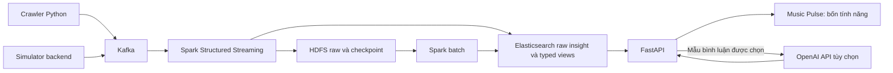

# Kiến trúc hiện hành

## Luồng dữ liệu

Code được mount từ ConfigMap, không build image ứng dụng riêng. `scripts/deploy.sh` áp manifest theo thứ tự phụ thuộc. Profile `full` có Kafka/ES/DataNode ba replica, Spark master/ba worker, một streaming driver và API có HPA. Đây là cấu hình một zone, không phải bảo đảm chống mất cả zone.

## Routing đang dùng

| Dữ liệu/query | Đích và vai trò |
|---|---|
| `ingest_raw` | Kafka raw → Parquet HDFS; giữ topic/partition/offset để đối chiếu |
| `insight_raw` | Charts/playlists/country charts → `music-insight-raw`; metadata type/crawl time/period cho query |
| `comment_samples` | Bình luận → `music-comments`, ID ổn định theo track/comment/sort |
| `rt_plays`, `rt_mentions`, `rt_charts` | Các typed realtime views của backend |
| `recommend` | Gợi ý backend, checkpoint cấu hình qua `RECOMMEND_CHECKPOINT_PATH` nếu có |
| Batch views/similarity | Đọc HDFS và ghi các bảng/index phục vụ backend; không tự coi mọi view là một màn hình UI |

Raw insight hiện không nhận `music.events`. Listening events thuộc luồng mô phỏng/backend; dashboard hiện tại không có nút play/skip/like gửi sự kiện nghe.

## API/dashboard

`/` phục vụ `insights.html`. Ba endpoint `/api/insights/lifecycle`, `/playlists`, `/countries` đọc dữ liệu theo feature/window. `/api/comments/tracks` chọn bài, `/api/comments/report` phân tích mẫu bình luận. Health/liveness riêng ở `/api/health` và `/api/live`.

Phân tích raw-history nặng có khóa theo process để tránh giữ nhiều working set đồng thời. Cache ngắn, raw cap 200.000; đây chưa thay thế materialized serving views cho tập lớn. Chế độ ES lỗi không ngầm đọc archive để trả dữ liệu cũ.

## State và giới hạn

- Kafka/HDFS/ES/Spark recovery dùng PVC theo manifest; checkpoint query không tự xóa khi update code.
- HDFS checkpoint service `k8s/21-hdfs-checkpoint.yaml` dùng để tránh edit logs tích lũy vô hạn trên NameNode nhỏ.
- SQLite báo cáo đặt trong volume ghi được của API; `emptyDir` không bền qua thay pod và không dùng chung giữa replica.
- Backend theo tỉnh/recommendation và công cụ offline còn phục vụ kiến trúc/dataset thử nghiệm, không phải dashboard thứ hai.
- Kiểm thử mock không chứng minh fault tolerance hoặc exactly-once; xem [cách kiểm chứng](04-kiem-thu.md).
